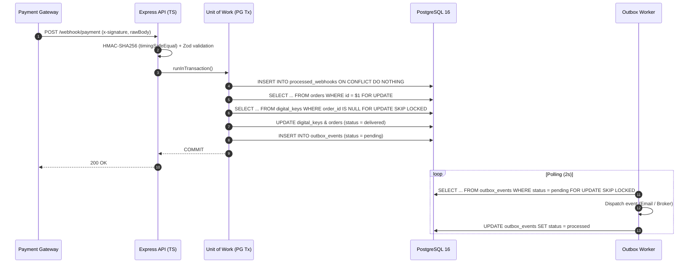

# Digital Marketplace Core: High-Concurrency Payment & Delivery Service

Отказоустойчивый сервис обработки платёжных вебхуков, атомарной выдачи цифровых товаров и гарантированной доставки событий на **TypeScript**, **Node.js** и **PostgreSQL 16**. Проект демонстрирует продакшн-подходы к защите от гонок (Race Conditions), дублей и проблемы двойной записи без внешних блокировок.

## Архитектура и поток обработки



## Ключевые инженерные решения
1. **Слоистая архитектура** на TypeScript с паттерном *Unit of Work* (`TransactionManager`) и иерархией доменных ошибок `DomainError`.
2. **Пессимистичные блокировки** (`FOR UPDATE SKIP LOCKED`) для высокой пропускной способности при конкурентной выдаче ключей.
3. **Двухуровневая защита вебхуков**: дедупликация через `ON CONFLICT DO NOTHING` и блокировка заказов через `SELECT ... FOR UPDATE`.
4. **Transactional Outbox Pattern**: атомарная запись событий в базу с асинхронным фоновым воркером доставки.
5. **Оптимизация схемы БД**: частичные индексы на `digital_keys` и атомарный контроль промокодов через `CHECK`-ограничения.
6. **Observability & Resilience**: структурированные JSON-логи (Pino), сквозной `x-request-id`, пробы `/health/live` / `/health/ready` и Graceful Shutdown.

Полную структуру проекта, команды быстрого запуска через Docker Compose и подробный список API-эндпоинтов можно найти в исходном репозитории проекта.
## Структура проекта

```text
├── client/                     # React + Vite UI (Витрина, Race Lab, Outbox-монитор)
├── server/
│   ├── src/
│   │   ├── api/                # HTTP-слой: роуты, Zod-валидация, HMAC, Error Handler
│   │   ├── config/             # Валидация env при старте приложения
│   │   ├── domain/             # Доменные сущности и типизированные ошибки
│   │   ├── infrastructure/     # Пул PostgreSQL, Unit of Work, Pino-логгер + ALS
│   │   ├── repositories/       # Инкапсуляция SQL-запросов
│   │   ├── services/           # Бизнес-логика (независимая от Express и БД)
│   │   └── workers/            # Фоновый OutboxWorker
│   └── tests/                  # Интеграционные тесты на Testcontainers
├── .github/workflows/ci.yml    # GitHub Actions CI (typecheck + integration tests)
├── docker-compose.yml          # PostgreSQL 16
└── schema.sql                  # Схема БД с частичными индексами и CHECK-ограничениями
```

## Быстрый запуск

```bash
# 1. Установка зависимостей (корень + фронтенд)
npm install && npm --prefix client install
cp .env.example .env

# 2. Запуск PostgreSQL 16 и накатка schema.sql
docker compose up -d

# 3. Запуск в режиме разработки (API на :3000 + Vite UI на :5173)
npm run dev
```

## Интеграционные тесты (Testcontainers)

Тесты поднимают изолированный контейнер PostgreSQL 16, накатывают схему и прогоняют 50 параллельных потоков на идемпотентность, фрод-атаку и гонку промокодов:

```bash
npm run typecheck
npm run test:integration
```

## API Эндпоинты

| Метод | Путь | Описание |
| :--- | :--- | :--- |
| `POST` | `/api/orders` | Создание заказа (поддержка `idempotency_key`) |
| `GET` | `/api/orders/:id` | Статус заказа и выданный цифровой ключ |
| `POST` | `/api/orders/:id/retry` | Повторная выдача для заказов в статусе `out_of_stock` |
| `POST` | `/webhook/payment` | Платёжный вебхук (`x-signature` HMAC-SHA256) |
| `POST` | `/api/promocodes/apply` | Атомарное применение промокода |
| `POST` | `/api/admin/refill` | Массовое пополнение пула ключей через `UNNEST` |
| `GET` | `/api/store/state` | Остатки, промокоды, заказы и очередь Outbox |
| `GET` | `/health/live` | Liveness-проба процесса |
| `GET` | `/health/ready` | Readiness-проба подключения к PostgreSQL |
